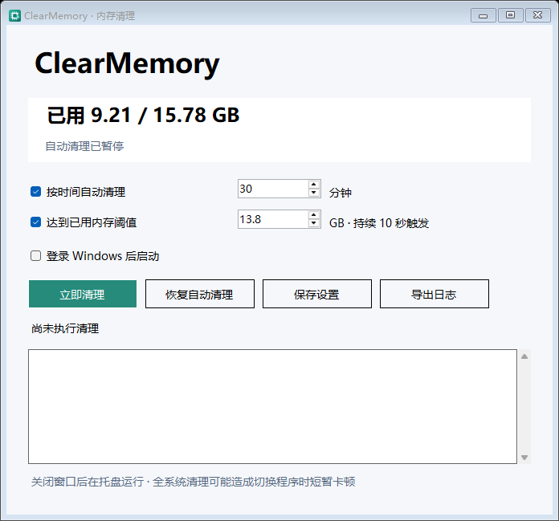

# ClearMemory

[简体中文](README.md) | [English](README.en.md)

**A lightweight, standalone, portable memory cleaner for Windows.**

[](https://github.com/Sukana-Zhang/ClearMemory/actions/workflows/build.yml)
[](LICENSE)

[Download the latest release](https://github.com/Sukana-Zhang/ClearMemory/releases/latest) · [Report an issue](https://github.com/Sukana-Zhang/ClearMemory/issues) · [Changelog (Chinese)](CHANGELOG.md)



The screenshot is an example. Memory readings and the initial threshold depend on your computer. **The application interface is currently in Chinese.** The control reference below explains the buttons and settings in English.

ClearMemory uses Windows system interfaces to perform manual or automatic memory cleanup. It does not require Lenovo PC Manager, ToolHub, Python, Docker, an API key, or an online service. The application makes no network requests and uploads no data. Release packages contain no personal settings, accounts, or logs.

## Requirements and download

The supported target is **Windows 10 or Windows 11, x64**. The application uses the .NET Framework 4.x runtime included with Windows. You do not need Visual Studio to run it. 32-bit Windows is not supported; ARM64 has not been verified and is not a supported target for this release.

1. Download `ClearMemory-<version>-win-x64.zip` from [Releases](https://github.com/Sukana-Zhang/ClearMemory/releases/latest). GitHub's automatically generated **Source code** archives contain source files, not a ready-to-run application.
2. Extract all files to a permanent location and run `ClearMemory.exe`. Allow the Windows administrator permission prompt.
3. Adjust the timer and memory threshold to your needs. You can also disable both automatic triggers and clean manually.

The release ZIP contains only the EXE, README, MIT license, and the EXE's SHA256 checksum file. A checksum for the ZIP is provided separately on the release page.

## Control reference

| Chinese label | Meaning |
| --- | --- |
| 立即清理 | Clean memory now |
| 按时间自动清理 | Enable scheduled cleanup |
| 分钟 | Interval in minutes |
| 达到已用内存阈值 | Enable cleanup when used physical memory reaches the threshold |
| 暂停自动清理 / 恢复自动清理 | Pause / resume automatic cleanup |
| 保存设置 | Save settings |
| 登录 Windows 后启动 | Start when you sign in to Windows |
| 打开内存清理 | Open the application from the tray menu |
| 打开日志目录 | Open the settings and log directory |
| 退出 | Exit completely |

## How automatic cleanup works

- **Manual cleanup:** available even while automatic cleanup is paused.
- **Timer:** enabled by default, with a 30-minute interval. You can choose 1–1440 minutes or disable the timer.
- **Memory threshold:** cleanup is triggered when used physical memory stays at or above the configured threshold for 10 seconds. The initial threshold is 87.5% of total physical memory, rounded down to one decimal place and capped at 14 GB. It is editable.
- The timer and threshold have separate switches. Manual and threshold-triggered cleanup do not postpone the next scheduled cleanup. Simultaneous triggers are combined into one operation.
- Only one cleanup runs at a time. After a cleanup, sustained high memory usage is observed for another 10 seconds before it can trigger again; there is no additional cooldown.
- Pausing stops both automatic triggers. Settings and the paused state persist across restarts. Saving settings or resuming monitoring starts the timer again.
- Closing the window keeps the application running in the system tray. A single left click on the tray icon opens the window. Use the tray's **退出 (Exit)** menu item to quit; wait for an active cleanup to finish first.
- Startup is **off by default**. Enabling it creates a scheduled task for the current user that starts the application in the tray with administrator privileges. If you move the EXE, run it once manually to update the startup path.
- Opening the application again in the same user session brings the existing window forward instead of starting another instance.

## Cleanup method and limitations

ClearMemory independently calls Windows interfaces for four operations:

1. Combine identical physical memory pages.
2. Reclaim system file cache.
3. Trim system working sets.
4. Reclaim low-priority standby pages.

It does not load or distribute Lenovo DLLs, require a vendor service, inject code, or terminate applications. If Windows rejects or does not support an operation, the application reports the status and continues with the remaining steps. Temporarily enabled process privileges are restored afterward.

**Cleanup affects the whole system. Games and browsers are not excluded.** Reported memory usage may drop, but this does not fix memory leaks. Applications may need to load data back into memory afterward, causing brief pauses when switching tabs, applications, or games. To reduce repeated disruption, disable the timer and use threshold-based or manual cleanup instead.

Changes in available memory include concurrent activity from other applications and are not an exact measurement of memory freed exclusively by ClearMemory. Higher game frame rates are not guaranteed. Avoid running multiple automatic memory cleaners at the same time.

## Settings, logs, and removal

Settings and rotating logs are stored in:

```text
%LOCALAPPDATA%\ClearMemory
```

The startup task is named `ClearMemory-<current user SID>`. It is separate from ToolHub and earlier Cleaner or SpaceCleaner applications.

To remove ClearMemory, disable **登录 Windows 后启动 (Start when you sign in)**, exit through the tray menu, and delete the extracted application directory. You may also delete the settings directory if you no longer need it.

The EXE is not digitally signed, so Windows may show an unknown publisher. Use a trusted release source and verify the supplied SHA256 checksums.

## Build and test from source

Clone or download this repository, then run these commands in Windows PowerShell from the repository directory:

```powershell
powershell -NoProfile -ExecutionPolicy Bypass -File .\build.ps1
powershell -NoProfile -ExecutionPolicy Bypass -File .\test.ps1
powershell -NoProfile -ExecutionPolicy Bypass -File .\package.ps1
powershell -NoProfile -ExecutionPolicy Bypass -File .\verify-package.ps1
```

The build uses Windows' C# compiler and requires no dependency downloads. Generated files stay in the repository's `build` and `dist` directories. No directory or drive from the author's computer is required. Use `package.ps1 -OutputDirectory <directory>` to choose another package output directory.

Verification includes 38 checks for scheduling, settings, startup behavior, and UI initialization; 28 checks for native request structure layouts and failure handling; and package allowlist, SHA256, and extracted-program checks using a path containing Chinese characters and spaces. Tests do not perform real system cleanup or register startup tasks.

GitHub Actions builds and tests on Windows Server 2022 and 2025. A matching version tag triggers a release after the checks pass. CI verifies build and basic initialization compatibility; it does not establish compatibility with every Windows 10/11 build or hardware configuration. Game frame-time effects have not been benchmarked.

The repository excludes runtime logs, personal settings, account data, and API keys. The application has no API key setting.

## Project layout and maintenance

| Directory | Contents |
| --- | --- |
| `src` | UI, scheduling, settings, startup, and Windows interface implementation |
| `tests` | Scheduling, native interface contract, and package test source |
| `tools` / `assets` | Icon generator source and application icon |
| `.github` | Windows CI, release workflow, dependency updates, and issue template |

Bug reports and pull requests are welcome. Include the application version, Windows version, architecture, reproduction steps, and whether another cleaner is running. Share only relevant log excerpts and remove private paths or other unnecessary personal information. Never attach passwords, API keys, or access tokens.

For releases, update `AssemblyVersion` and `AssemblyFileVersion` in `src/App.cs` and the changelog, then push a matching tag such as `v1.0.0`. Automated checks detect regressions; fixes still require a code change. Additional contribution guidance is in [CONTRIBUTING.md (Chinese)](CONTRIBUTING.md).

Licensed under the [MIT License](LICENSE). Windows system components are provided by Microsoft; this package does not bundle Microsoft runtimes or third-party applications.
